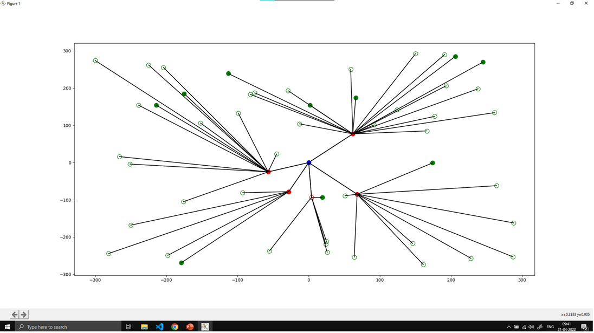

# Fog and Cloud Task Scheduling Simulation

> **Archived.** Superseded by [fog-scheduling](https://github.com/VarunAgarwalOfficial/fog-scheduling), which compares six policies on the same workloads over many seeds. This repository is kept as a record and is read-only.

A Python simulation of a three-tier network (users, fog nodes, one cloud node) used to compare task scheduling policies: Shortest Job First, Priority, and a hybrid of the two. This is coursework, not a published paper.



## Why it is interesting

- The network is built from random positions: 5 fog nodes, 50 users and a cloud node at the origin. Each user links to its nearest fog node and every fog node links to the cloud. Each step, a user creates a task with probability 0.2, with a random priority and length from 1 to 9.
- Fog nodes are assumed to be limited and the cloud elastic but further away: sending a task to the cloud adds a fixed delay, while the notebooks price cloud compute lower than fog compute (0.76 against 1.36 per unit). Each step a fog node works on one task and sends the rest to the cloud. In `SJF.py` the fog node keeps the shortest job and sends short tasks (length under 5) straight to the cloud; in `Priority.py` it keeps the highest-priority task and sends tasks with priority under 5 to the cloud.
- The hybrid (`SJR_Priority.py`) orders fog work by priority and cloud work by job length. In the recorded results, priority scheduling cost less than SJF but traded away response time, and the hybrid sat between the two.
- The results (response time by priority and fog versus cloud compute and cost) are in `Data/`, with the analysis notebooks in `Results analysis/` and charts in `screenshots/`.

## Run it

```bash
pip install numpy matplotlib
python SJF.py
python Priority.py
```

Each script runs 10,000 steps, redraws the network in a Matplotlib window at every step with a one-second pause (so a full run takes hours), and then writes its results (`data_sjf3.json`, `data_p3.json`) to the current directory.

`SJR_Priority.py` does not run as committed: it stops with an `AttributeError` on the task's `time` attribute, and the 2022 version stopped with a `TypeError` instead. The hybrid results in `Data/data_sjf_priority*.json` must have come from a version that was never committed.

To look at the results:

```bash
pip install jupyter
jupyter notebook "Results analysis"
```

The notebooks open data files by bare name (for example `data_p2.json`), so copy the file they need from `Data/` into `Results analysis/` first.

## Tech

Python, NumPy, Matplotlib, Jupyter.

## Context

VIT coursework, BCT3005 Fundamentals of Fog and Edge Computing, group project, Winter semester 2022 (April 2022). A later rewrite: https://github.com/VarunAgarwalOfficial/fog-scheduling

## License

MIT, see LICENSE.
